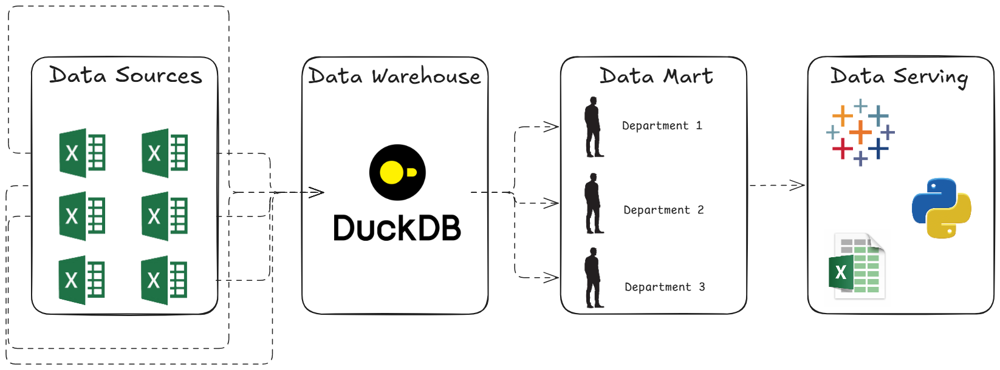

# <center> 👷🏻‍♂️ Data Engineering Project: Data Warehouse + Data Marts 👷🏻‍♂️ </center>

## 🚨 The Problems

1. In most companies, especially the big ones, have their data scattered into many sources: CRMs, billing systems, spreadsheets, or even 3rd party API.
2. Each department inside the company need to access different kind of data. Relying only on raw data can be too complex for most business users.
3. Operational databases are built for transactions not heavy aggregations.
4. Raw data often contains many unreliable values: missing values, duplicates, and inconsistent format.

## 💡 Solution

Draft answer for each point on the problems:
1. Data warehouse / data lakehouse that unite all scattered data
2. Data marts that contain specific department data for them to access
3. Data warehouse / data lakehouse instead of operational database
4. Data validation

<font color='red'> **Final Solution** </font> → Build a data warehouse that unites all scattered data sources, do a data validation, then create data marts for different departments.

## 🧾 Specification



## 🧩 Decomposition

### Data Sources
For this project, the data source is in form of CSV and scattered into four files. The dataset was provided by Luke Barousse (see the references section) by doing web-scraping. In order to load this four files into a single data warehouse, the four tables are needed to be set up first.

[1. Create Four Tables](/Data%20Warehouse%20&%20Data%20Marts/1_create_tables.sql) <br>
[2. Load All Data Sources Into Four Tables](/Data%20Warehouse%20&%20Data%20Marts/2_load_schemas.sql)

Here are the download link to the datasets: <br>
[Company Table | Dimension](https://storage.googleapis.com/sql_de/company_dim.csv) <br>
[Job Postings Table | Fact](https://storage.googleapis.com/sql_de/job_postings_fact.csv) <br>
[Skills Table | Dimension](https://storage.googleapis.com/sql_de/skills_dim.csv) <br>
[Skills and Job Bridge Table | Dimension](https://storage.googleapis.com/sql_de/skills_job_dim.csv) <br>

### Data Warehouse
After loading all the data into one singular source, the data warehouse is now ready. Why is it called data warehouse and not database? Well, data warehouse is a large database optimized for analytics purpose. Later we will see why this should be called data warehouse. All the original datasets are put into main schemata.

### Data Marts

For the data marts, I have built three data marts:
1. Flat Marts

    Instead of using star schema like the datasets in the main schemata, flat mart is a data mart built as one wide and denormalized table, consisting of facts and descriptive column into a single table. But, what good is flat mart for?

    1.1 **Self-Reporting**: Data Analyst and even consumers can query this table without needing to know the relation of datasets, it's built for reporting simplicity.
    
    1.2 **Daily Case**: This mart is optimized for daily reporting, especially where the report is mostly similar everyday and the rows are humongous. For the joins are done once in the load section, query will not be demanding on the engine and cut the cost efficiently.

2. Skill Marts

    In this particular case, this mart is specifically built for people who want to analyze the trend for each skill and each job. It contains three tables:

    2.1 **Date Dimension**: Contains Year, Month, Quarter

    2.2 **Skills Dimension**: Contains Skill ID, Skill Name, and Skill Type 

    2.3 **Skill Demand Fact**: Main Table for Analysis

3. Priority Job Marts
    
    This mart is specifically built maybe for HR Department who casually needs to update the priority level of job title for hiring purpose. The distinct most important feature in this the incremental update. I incorporate ```MERGE INTO``` into the script.

## 📝 Final Testing

<!--
Display the query and
-->

## 🧠 Skill Display

<!--
List all the skills I've learnt in this project
-->